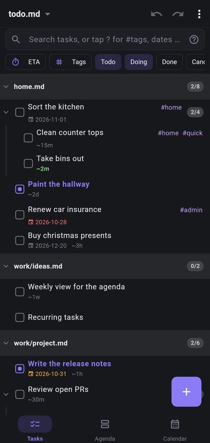
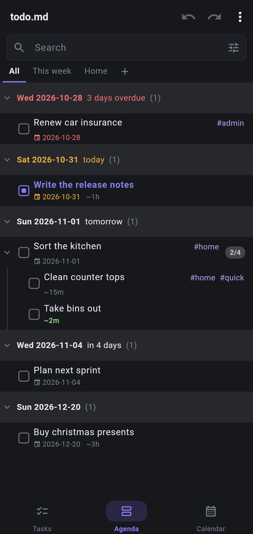
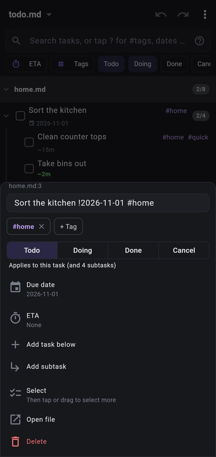
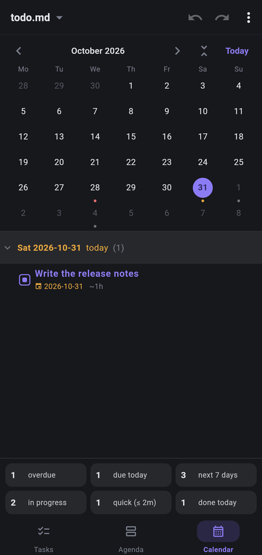

# Todo.md (app)

The phone version of [todo.md](https://github.com/joereynolds/todo.md).

Point it at a folder of notes and it'll find every task in every `.md` file.

<p align="center">
  
  
  
  
</p>

## Installing

### Android

TBD

### iOS

Lol. Build it yourself and pray.

### From source

Needs Flutter.

```
flutter build apk --release --split-per-abi
adb install build/app/outputs/flutter-apk/app-arm64-v8a-release.apk
```

### Filtering

Same as the desktop

```
kitchen            tasks or file paths with "kitchen" in them
due:overdue        also due:today, due:week, due:none, due:any
is:doing           also is:todo, is:done, is:cancelled, is:open
~<=15m             quick stuff. Also ~<1h, ~>2h, ~>=1d, ~none, ~any
```

Stack them up. `due:week ~<=15m` is everything quick due this week.

## Markdown

It's the same syntax as the desktop app, see the
[README there](https://github.com/joereynolds/todo.md#markdown-representation).

```
- [ ] Sort the kitchen !2026-11-01
  - [x] Fix the tap x2026-10-29
  - [ ] Clean counter tops ~15m
  - [ ] Take bins out ~2m
- [/] Paint the hallway ~2d
```

Enjoy!
